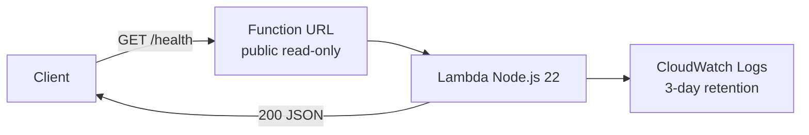

# CloudPulse

**Minimal, working AWS serverless health-check API** — Lambda Function URL + AWS SAM + GitHub Actions CI. Built as a beginner-friendly DevOps portfolio project: small surface area, real infrastructure-as-code, and explicit cost/cleanup guidance.

> **Public URL warning:** This demo uses a Lambda Function URL with `AuthType: NONE`. **Anyone can invoke it.** That is intentional only because the API is read-only, holds no secrets/database, and performs no privileged operations. Public traffic can still **incur AWS usage costs**. Delete the stack when you are done.


---

## What it does

| Method & path | Result |
| --- | --- |
| `GET /health` | HTTP **200** JSON: service, status, environment, deployment version, live ISO timestamp |
| Anything else | HTTP **404** JSON |

No API Gateway, no database, no VPC, no containers, no third-party APIs, no paid npm dependencies.

---

## Architecture



Full write-up: [docs/architecture.md](docs/architecture.md).

| Resource | Purpose |
| --- | --- |
| `AWS::Serverless::Function` | Health handler (`src/app.js`) |
| Lambda Function URL | HTTPS endpoint without API Gateway |
| CloudWatch Log Group | Structured logs, **3-day** retention |
| Short log retention + tiny memory | Keeps demo cost/risk low |
| CloudFormation Outputs | Publishes the Function URL after deploy |

---

## Screenshots (placeholders)

Add your own after a successful deploy — recruiters love proof.

| Placeholder | Suggested capture |
| --- | --- |
| `docs/screenshots/health-200.png` | Browser or terminal showing `GET /health` JSON |
| `docs/screenshots/cloudformation-outputs.png` | Stack **Outputs** with `HealthFunctionUrl` |
| `docs/screenshots/github-actions-ci.png` | Green CI run (tests + `sam build`) |

---

## Example API response

Illustrative only (timestamp and version will differ when you call a live URL):

```json
{
  "service": "CloudPulse",
  "status": "healthy",
  "environment": "production",
  "version": "1.0.0",
  "timestamp": "2026-11-03T18:00:00.000Z"
}
```

---

## Project layout

```
├── src/
│   ├── app.js           # Lambda handler
│   └── package.json     # "type": "module" for the deployment package
├── tests/
│   └── app.test.js      # node:test suite
├── template.yaml        # AWS SAM / CloudFormation
├── package.json         # scripts + Node 22 engine
├── .github/workflows/
│   ├── ci.yml           # test + sam validate/build (no AWS secrets)
│   └── deploy.yml.example  # OIDC deploy — enable only after IAM setup
└── docs/
    ├── architecture.md
    └── oidc-cd-upgrade.md
```

---

## Prerequisites (Windows PowerShell)

### 1. Check or install AWS CLI

```powershell
aws --version
```

If missing, install from [AWS CLI for Windows](https://docs.aws.amazon.com/cli/latest/userguide/getting-started-install.html), then reopen PowerShell and re-check.

### 2. Check or install AWS SAM CLI

```powershell
sam --version
```

If missing, follow [Install the AWS SAM CLI](https://docs.aws.amazon.com/serverless-application-model/latest/developerguide/install-sam-cli.html) (Windows MSI), then reopen PowerShell.

### 3. Configure credentials (non-root, prefer IAM Identity Center)

Do **not** use the account root user.

**Preferred — IAM Identity Center (SSO):**

```powershell
aws configure sso
```

Follow the prompts (start URL, region, account, role). Then:

```powershell
aws sso login --profile YOUR_PROFILE_NAME
$env:AWS_PROFILE = "YOUR_PROFILE_NAME"
aws sts get-caller-identity
```

**Alternative — IAM user access keys (local only):** create a least-privilege IAM user/role for CloudFormation, Lambda, Logs, IAM (for the function execution role), and S3 (SAM packaging). Run `aws configure` and store keys only on your machine — **never** commit them and **never** put them in GitHub Secrets for this project’s recommended path.

Permissions you need locally roughly match what SAM deploy uses: CloudFormation stack ops, Lambda, Logs, IAM role create/pass for the function, and an S3 bucket for artifacts (`sam deploy --guided` can create one).

---

## Local development

```powershell
cd "C:\Users\Dell 5520\Desktop\Awspractice"
node --version   # expect v22+
npm test
```

---

## Deploy with SAM (PowerShell)

Replace `REGION` with your region (for example `us-east-1`).

```powershell
# From the project root
sam validate
sam build
sam deploy --guided
```

Guided prompts (typical answers):

| Prompt | Suggested value |
| --- | --- |
| Stack name | `cloudpulse-demo` |
| AWS Region | your `REGION` |
| Parameter DeploymentVersion | `1.0.0` |
| Confirm changes / allow IAM | `Y` as prompted |
| Save arguments to config | `Y` (creates local `samconfig.toml`, gitignored) |

After deploy, copy **`HealthFunctionUrl`** or **`HealthCheckEndpoint`** from the Outputs section.

### Test on Windows

```powershell
# If you used HealthFunctionUrl (ends with /):
curl.exe -s "https://YOUR_ID.lambda-url.REGION.on.aws/health"

# Or paste HealthCheckEndpoint as-is:
curl.exe -s "https://YOUR_ID.lambda-url.REGION.on.aws/health"
```

Expect HTTP 200 and JSON with `"status":"healthy"`.

---

## Cleanup (stop charges)

```powershell
sam delete --stack-name cloudpulse-demo --region REGION
```

Confirm when prompted. This removes the Lambda function, Function URL, and the managed log group from the stack. Also delete any SAM-created artifact bucket if you no longer need it (S3 console or CLI) — guided deploy may have created one outside the stack.

---

## CI (no AWS credentials)

[`.github/workflows/ci.yml`](.github/workflows/ci.yml) runs on push and pull request:

1. Checkout  
2. Set up Node.js 22  
3. `npm test`  
4. Set up AWS SAM CLI  
5. `sam validate`  
6. `sam build`  

CI does **not** deploy and does **not** need AWS secrets.

---

## Future: OIDC continuous deploy

To deploy from GitHub **without static AWS keys**, configure an IAM role trusted for your repo + `main` branch only, then enable the example workflow. Step-by-step: [docs/oidc-cd-upgrade.md](docs/oidc-cd-upgrade.md).

---

## Cost notes

This project is designed to stay cheap at idle:

- **128 MB** memory, **5 s** timeout  
- Log retention **3 days**  
- No API Gateway, NAT, or always-on compute  
- Reserved concurrency is documented but **not set by default** — new accounts often have a Lambda concurrency quota of **10**, and AWS requires **10 unreserved**, so reserving concurrency fails until you raise the quota  

You still pay for invocations, a tiny duration charge, and log ingestion/storage while the stack exists. A public Function URL can be called by anyone — that is the main cost risk. **Delete the stack** after demos.

Exact pricing depends on region and usage; check the current [AWS Lambda pricing](https://aws.amazon.com/lambda/pricing/) page.

---

## Troubleshooting

| Symptom | What to try |
| --- | --- |
| `sam` / `aws` not recognized | Reinstall CLI, restart PowerShell, confirm PATH |
| `ExpiredToken` / SSO errors | `aws sso login --profile YOUR_PROFILE` |
| `AccessDenied` on deploy | Add CloudFormation/Lambda/Logs/IAM/S3 permissions to your identity |
| `nodejs22.x` rejected | Use a region that supports Node.js 22, or update SAM CLI |
| 404 on `/health` | Ensure you call `/health` on the Function URL (not only the bare URL path `/`) |
| CI `sam validate` fails | Run `sam validate` and `sam build` locally; ensure `template.yaml` is valid YAML |
| Deploy fails: `UnreservedConcurrentExecution below its minimum value of [10]` | New-account Lambda quota issue. This project omits reserved concurrency for that reason. Delete the failed stack and redeploy. Later you can raise the concurrency quota in Service Quotas, then optionally set `ReservedConcurrentExecutions` |
| Stack left in `CREATE_FAILED` | `sam delete --stack-name STACK_NAME --region REGION` then deploy again |

---

## Learning outcomes

- Package a Node.js 22 Lambda with ES modules and SAM  
- Expose HTTPS without API Gateway via Function URLs  
- Cap risk with short log retention and a tiny Lambda footprint  
- Write portable tests with Node’s built-in test runner  
- Run credential-free CI that still validates IaC (`sam build`)  
- Plan a secure CD path with GitHub OIDC (no long-lived keys)

---

## License

MIT — use freely for learning and portfolio demos.
