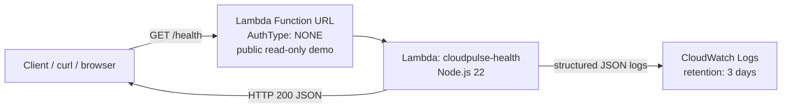

# CloudPulse architecture

CloudPulse is a **read-only** serverless health-check API. A single AWS Lambda function is exposed through a **Lambda Function URL** (no API Gateway). Clients call `GET /health` and receive a small JSON payload. Structured logs go to CloudWatch Logs with a **3-day** retention period.

## Diagram

## Request flow

1. A client sends `GET /health` to the Function URL.
2. Lambda runs `src/app.js` (`handler`).
3. On a match, the function returns HTTP **200** with `service`, `status`, `environment`, `version` (from `DEPLOYMENT_VERSION`), and a live ISO `timestamp`.
4. Any other path or method returns HTTP **404** JSON.
5. Each invocation emits a structured log line to CloudWatch (no secrets or PII).

## Design constraints (intentional)

| Included | Excluded (keeps cost and scope low) |
| --- | --- |
| Lambda + Function URL | API Gateway |
| CloudWatch Logs (3-day retention) | Databases, DynamoDB |
| SAM / CloudFormation | EC2, VPC, containers |
| GitHub Actions CI (test + `sam build`) | Automatic CD (optional OIDC upgrade) |
| Tiny Lambda + 3-day logs | Third-party APIs / paid npm packages |

## Security note (public URL)

`AuthType: NONE` means **anyone on the internet can invoke** this Function URL. That is acceptable only because the API is:

- read-only
- free of secrets, credentials, and account identifiers in responses
- free of mutations, databases, and privileged operations

Public invocations still count toward Lambda usage and may incur **cost**. Cap risk with short log retention, a small memory setting, and prompt cleanup (`sam delete`) when you are done demonstrating. New AWS accounts often cannot set reserved concurrency until the account concurrency quota is increased.

## Related docs

- [OIDC continuous deployment upgrade](./oidc-cd-upgrade.md)
- [Root README](../README.md) — setup, deploy, cleanup, interview talking points
